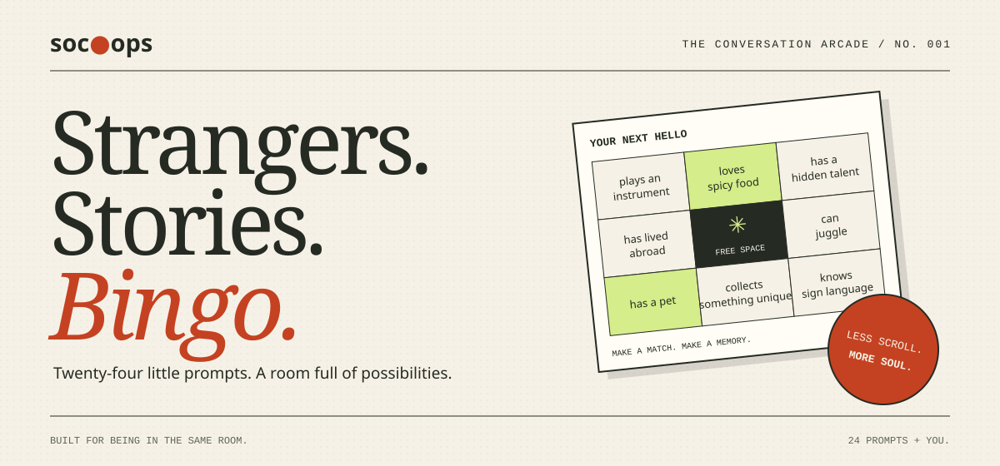

🌐 [Português (BR)](README.pt_BR.md) · [Español](README.es.md)



# Soc Ops / The conversation arcade

### Strangers. Stories. Bingo.

**Less scroll. More soul.** Social bingo for real-world connections, built with Java — and ready for your next GitHub Copilot experiment.

Put down the feed. Pick up a conversation. Find someone who plays an instrument, loves spicy food, or has a hidden talent. Every match on your 5×5 board is a reason to say hello; every hello could become a story.

**[Start playing](#get-started)** · **[Take the workshop](#build-along-with-the-workshop)** · **[Explore the code](#inside-the-project)**

**Java 21** · **Spring Boot** · **Thymeleaf** · **MIT licensed**

---

## Your next hello is on the card.

> “You have a hidden talent? Now I have to know.”

That is the idea behind Soc Ops: each square is a conversation starter, not just a box to tick. Bring it to a team meetup, conference mixer, or community gathering and give everyone an easy opening.

| What you get | Why it matters |
| --- | --- |
| **A shuffled board every game** | 24 icebreaker prompts and a centre free space keep introductions moving. |
| **Tap-to-mark squares** | Stay focused on the people, not the interface. |
| **Progress saved in your browser** | Pick up where you left off when browser storage is available. |
| **Rows, columns, and diagonals** | Five in a row earns a bingo celebration; you can keep playing afterward. |
| **A responsive, touch-friendly layout** | Take your board with you as you work the room. |

**The house rules:** no player accounts, no database to configure, no icebreaker speeches. Just launch the app and work the room.

### A little paper. A lot of personality.

The interface takes its cues from printed game cards: warm paper, ink outlines, burnt-orange accents, lime-green matches, oversized serif headlines, and tactile buttons. A tilted sample card welcomes you in; the playable board stays upright and readable. Motion is subtle and respects reduced-motion preferences.

## Three moves. One better introduction.

1. **Work the room.** Start a game and find someone who matches a prompt.
2. **Make your mark.** Tap their square. Ask for the story.
3. **Connect five.** Complete a row, column, or diagonal. The centre space is on us.

**The real win:** leave with a few new names and a story you would not have heard otherwise.

## Get started

From the repository root, all you need is a **Java 21 JDK**. The included Maven Wrapper handles Maven; its first run requires internet access to download Maven and dependencies.

```bash
cd socops
./mvnw spring-boot:run
```

Open [http://localhost:8080](http://localhost:8080) to play.

On Windows, use `mvnw.cmd spring-boot:run` from the `socops` directory instead.

### Build, test, and lint

```bash
cd socops
./mvnw clean package
./mvnw test
./mvnw verify
```

`clean package` builds the application and runs tests. `test` runs the tests alone. `verify` runs tests and Checkstyle checks for unused imports and Java formatting conventions.

## Build along with the workshop

**Come for the game. Stay to build something of your own.**

Soc Ops is also the starting point for a guided GitHub Copilot lab. Work through context engineering, frontend design, custom agents, and multi-agent development using a small, runnable Java application.

**[Open the workshop guide →](workshop/GUIDE.md)**

| Step | What you’ll explore |
| --- | --- |
| [00 · Get oriented](workshop/00-overview.md) | Overview & checklist |
| [01 · Set the context](workshop/01-setup.md) | Setup & context engineering |
| [02 · Shape the experience](workshop/02-design.md) | Design-first frontend |
| [03 · Meet the Quiz Master](workshop/03-quiz-master.md) | A custom agent for icebreaker prompts |
| [04 · Build as a team](workshop/04-multi-agent.md) | Multi-agent development |

Prefer another language? Read the workshop in [Português (BR)](workshop/pt_BR/GUIDE.md) or [Español](workshop/es/GUIDE.md). All workshop material lives in the repository for offline reading.

## Inside the project

A deliberately compact stack: **Spring Boot** serves the page and generates boards, **Thymeleaf** renders the template, and **plain JavaScript** handles marking squares, detecting bingo, and saving browser progress. Custom CSS utilities keep styling local, without an external CSS framework.

| Path | What’s inside |
| --- | --- |
| [`socops/src/main/java`](socops/src/main/java) | Board generation, bingo rules, and the web controller |
| [`socops/src/main/resources/templates`](socops/src/main/resources/templates) | The game and lobby page |
| [`socops/src/main/resources/static`](socops/src/main/resources/static) | Styles and static assets |
| [`socops/src/test/java`](socops/src/test/java) | Tests for board generation and game rules |
| [`.github/agents/`](.github/agents/) | Custom agents for design, quizzes, reviews, and TDD |
| [`workshop/`](workshop/GUIDE.md) | A hands-on guide to building and extending the project |

Want to make it your own? Start with the [icebreaker prompt catalogue](socops/src/main/java/com/socops/data/IcebreakerPrompts.java) or the [game template](socops/src/main/resources/templates/game.html).

Keep the look consistent with the [design guide](.github/copilot-instructions.md#design-guide): palette, typography, layout, motion, and accessibility are documented for contributors and Copilot.

## Join in

Ideas and contributions are welcome. Read the [contributing guide](CONTRIBUTING.md) and [code of conduct](CODE_OF_CONDUCT.md) before opening a pull request. For help, see [support](SUPPORT.md); for security concerns, follow the [security policy](SECURITY.md).

Soc Ops is available under the [MIT License](LICENSE).

---

**Built for being in the same room. Twenty-four prompts + you.**
